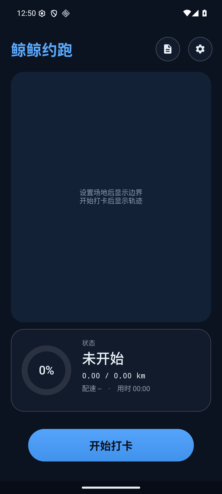
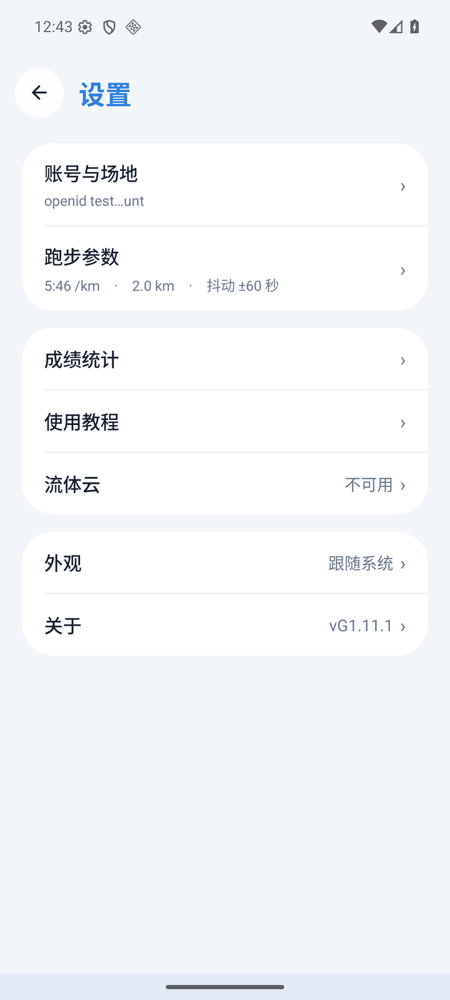
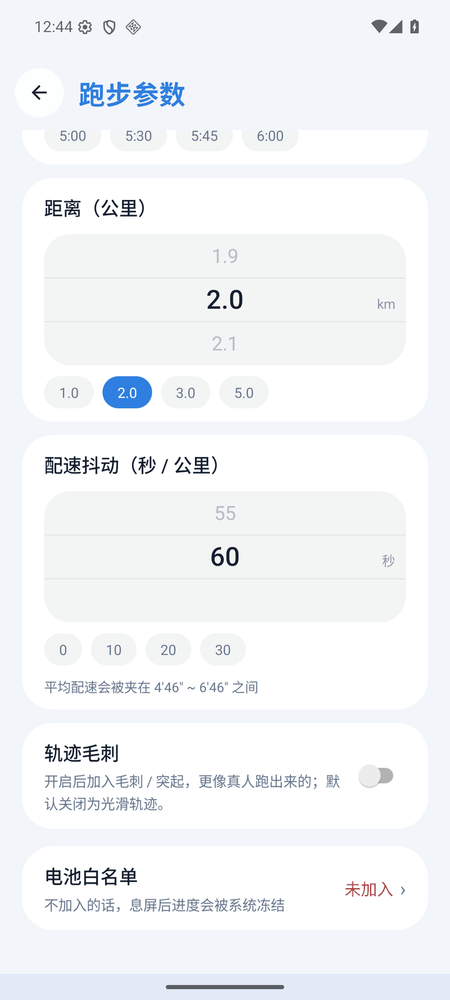
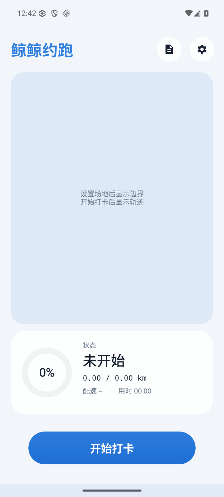
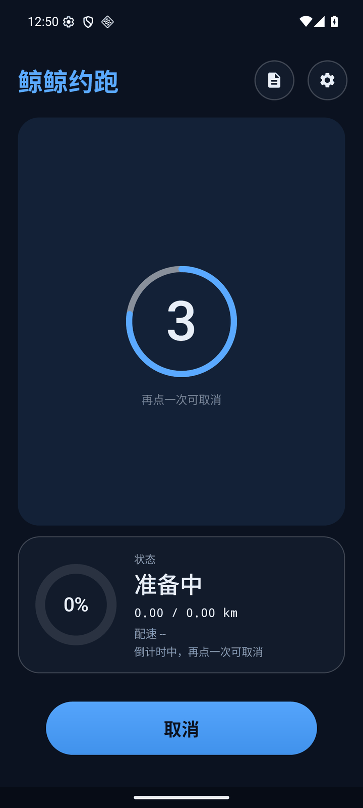
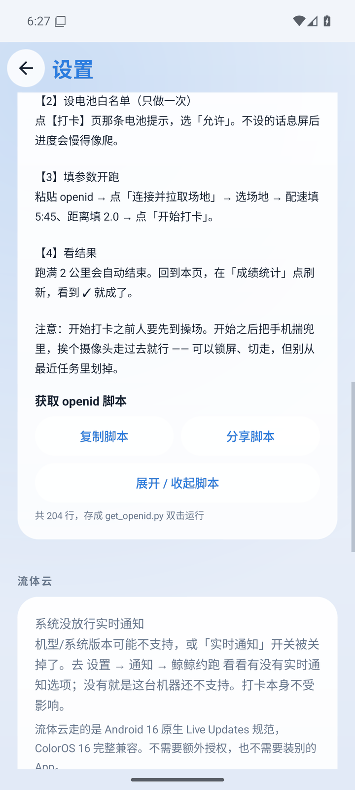
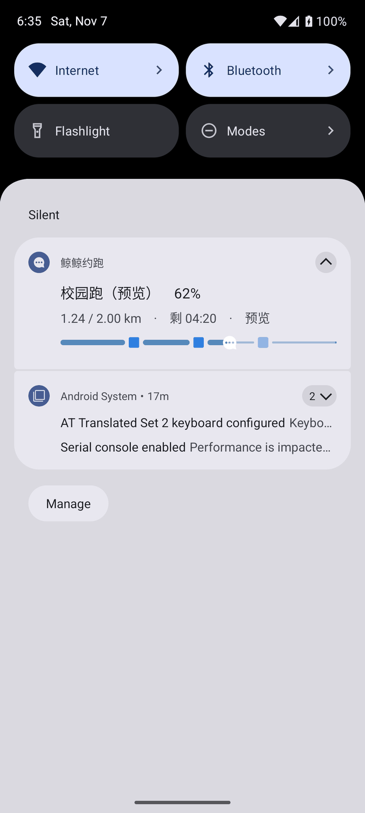
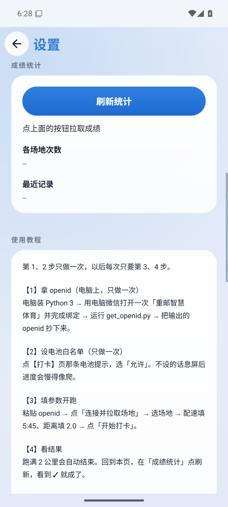

# 鲸鲸约跑

> 填一次 openid，它自己把 2 公里跑完。你只负责去摄像头下面走一趟。

微信小程序「重邮智慧体育」的打卡工具，**安卓单机版**。
不申请定位权限，不连服务器，不需要登录，不给别人用。

<p align="center">
  
</p>

**当前版本 vG1.12.0** · [**下载 APK**](https://github.com/gufandf/CQUPT-MockRunning/releases/latest) · [变更记录](CHANGELOG.md) · [文件说明](#六文件说明)

---

## 一、它长什么样

主页只有两件事：**看地图**和**点开始**。

| | |
|---|---|
| **主页** | 地图（绿色边界、暗红禁跑区、红色实时轨迹）+ 底部固定的【开始打卡】 |
| **设置**（右上角齿轮） | 账号：openid / 连接 / 场地<br>跑步：配速 / 距离 / 配速抖动 / 拟真轨迹开关<br>统计：全部记录卡片（点开看轨迹、导出 GPX）<br>教程：使用步骤 + 取码脚本<br>流体云：胶囊状态 + 发一条测试胶囊<br>外观：主题<br>关于：版本 / 本项目仓库 / 原仓库 |

运行日志是独立的一页，从顶栏右上角的小图标进入。设置页走标准 Activity 转场，
所以侧滑返回是系统原生的跟手动画。

界面是流体设计那一套：**纯色底**、24dp 圆角玻璃卡片、胶囊按钮。设置页是「分组卡片 + 行」的结构，
一行一件事，和 ColorOS 设置页一致。
**按钮是按下去会变形的**：按住拖动，它会沿手指方向鼓起来、横向收窄（面积守恒），
松手荡一下再收住；「场地」这类选项则从字段处沿一条弧线飞出来的弹出菜单里选。
深色跟着系统走：



跑起来是这样：

| 运行日志 |
|---|
|  |

---

## 二、怎么用

一共四步。**第 1、2 步只需要做一次**，以后每次跑只要第 3、4 步。

### 第 1 步：拿 openid（只做一次）

openid 是你在小程序里的身份编号。**换登录凭证只需要这一个东西**，
所以拿一次就能一直用，不用密码、不用验证码。

它存在电脑版微信的缓存里。手机拿不到（存在微信私有目录，除非手机 root），
所以这一步**要找一台电脑**：

1. 电脑装 [Python 3](https://www.python.org/downloads/)（安装时勾上 **Add to PATH**）
2. 电脑微信打开一次「重邮智慧体育」，完成登录绑定
3. 把 [`get_openid.py`](get_openid.py) 存到电脑上，双击运行
4. 输出里的 openid 抄下来

```
找到 1 个身份：

  [1] openid
      oXXXXXXXXXXXXXXXXXXXXXXXXXXX

把这个 openid 填进 App 设置页的 openid 输入框即可
```

> **懒得传文件？** App 设置页的【使用教程】分段里有同一份脚本，
> 点「分享脚本」可以直接当 `.py` 文件发到微信文件传输助手，电脑上双击就能跑。
>
> **不用退出微信。** 读的是 HTTP 缓存不是数据库文件，微信开着也能读。

### 第 2 步：设置一次电池白名单（重要）

安卓的深度省电（Doze）会**冻结后台的 CPU 和网络**，连 CPU 唤醒锁都会忽略。
不设置的话，你把手机揣兜里息屏，进度会慢得像爬 —— 只有「用时」在涨。

打开 App，配速/距离下面有一条**红色**的提示：


点它 → 系统弹窗问「允许应用始终在后台运行吗」→ 选**允许** →
按返回键回到 App，那条会自己变成**绿色**：


**只用设置一次。**

### 第 3 步：填参数开跑

参数都在右上角【设置】里（主页只留地图和【开始打卡】）：

<p>


</p>

| 填什么 | 填多少 |
|---|---|
| openid | 第 1 步拿到的 |
| 配速 | **5:45**（规则要求 4'00" ~ 7'30"，取中间最稳） |
| 距离 | **2.0**（规则要求 2000 米） |
| 场地 | 你实际要去的那个（风华运动场 / 太极运动场 / 宁静苑） |
| 配速抖动 | 留默认 **20**（秒/公里）即可 |

> 点【连接并拉取场地】如果连不上服务器，会直接弹一个「无法连接到服务器」的提示框，
> 告诉你去检查网络，而不是默默留一个空场地列表。

回到主页长这样 —— 纯色底、24dp 圆角的玻璃卡片、一颗胶囊形的【开始打卡】：



点【开始打卡】后，地图上会出现一个 **3 秒倒计时**（环 + 秒数）。
它既是「马上要开跑了」的确认，也是一个**反悔窗口** —— 倒计时没走完时再点一次按钮就取消：



然后——

> **点「开始」之前，人先进操场。**
> 然后点开始，把手机揣兜里，**挨个摄像头走过去**。

自动打卡过程中：

- 可以退出 App、锁屏、切到别的应用 —— **进度不会丢**（前台服务守着）
- **流体云胶囊**：进度收进状态栏胶囊，展开是实时活动（ColorOS 16 / Android 16 起）
- **别在后台划掉它**（从最近任务里划走会终止）

流体云不需要额外授权，也不需要装别的 App —— ColorOS 16 的流体云完整接入了
Android 16 原生的 Live Updates 规范。设置页里能看到当前状态，还能发一条测试胶囊：



胶囊/实时活动长这样（四段分色的进度条 + 三个里程碑点）：



回到 App 会看到实时仪表盘：


```
进度        XX%
已跑        XXXX / XXXX km
用时 XX:XX  剩余 XX:XX
配速 X'XX"/km · 状态 上传中
批次 XX/99 · 点位 XXX/XXX
服务端累计 XXXX km / XX:XX
```

跑满 2 公里会**自动结束**，不用手动点。

### 第 4 步：看结果

跑完进【设置】→【成绩统计】，点「刷新」：



看到 `✓` 就成了。

> 服务端会做两个判定：
> 1. **配速 / 里程** —— 工具保证达标
> 2. **人脸检测** —— `锻炼时间内无跑步检测` / `跑步检测过少`
>
> 第 2 条**只能靠你本人到场**。这一点无解，工具也绕不过去。

---

## 三、常见问题

<details>
<summary><b>手机能不能直接拿 openid？</b></summary>

不能。openid 存在微信自己的私有数据目录里，普通 App 没权限读（除非手机已 root）。
电脑版微信 4.x 把小程序跑在 Chromium 里，请求缓存是**明文 JSON**，所以能直接读。
这就是为什么必须借一台电脑。
</details>

<details>
<summary><b>脚本说「没找到 openid」？</b></summary>

按顺序检查：

1. 电脑微信里**打开过一次**「重邮智慧体育」并完成绑定 —— 没打开过就没缓存
2. 换个账号试 —— 脚本只找**这台电脑上登录过的微信号**
3. 微信开着也没关系（v1.8 起用 `CreateFileW` 绕过了文件锁，之前要退出微信）
</details>

<details>
<summary><b>进度条不走 / 只有用时在涨？</b></summary>

第 2 步的电池白名单没设。去设置成绿色再跑。
</details>

<details>
<summary><b>配速设多少？</b></summary>

**5:45**。服务端规则是 `minPace = 4.0` `maxPace = 7.5`，也就是 4'00" ~ 7'30" 之间。
取中间段最保险，别贴着边界设。
</details>

<details>
<summary><b>能设更长的距离吗？</b></summary>

规则要求 2000 米，跑满 2 公里就够。设更长没有意义，设更短不达标。
</details>

---

## 四、你需要准备什么

| 东西 | 说明 |
|---|---|
| 一台安卓手机 | Android 7.0+，HarmonyOS 4.0 实测可用 |
| 一台电脑 | 只为了跑一次 `get_openid.py`（拿完 openid 就不用了） |
| 电脑版微信 | 在这台电脑上打开过一次「重邮智慧体育」 |
| 你本人 | 去操场摄像头下面走一趟 |

---

## 五、自己编译

```bash
cd android-app
./gradlew assembleRelease        # Windows 用 gradlew.bat
```

需要 **JDK 17** + **Android SDK 34**。产物在 `app/build/outputs/apk/release/`。

详细的构建说明、工具链摆放、踩坑记录见 **[`android-app/README.md`](android-app/README.md)**。

---

## 六、文件说明

| 文件 | 作用 |
|---|---|
| [`android-app/`](android-app/) | 📱 **成品 App** —— 源码 + 构建说明 |
| [`get_openid.py`](get_openid.py) | 本地提取 openid（零解密、不联网） |
| [`wecat_run.py`](wecat_run.py) | 命令行版客户端（电脑上跑，不用装 App） |
| [`draw_text.py`](draw_text.py) | **写字版**：在场地里顺时针写下「重庆邮电大学」，手写效果 |
| [`track_engine.py`](track_engine.py) | 轨迹引擎 Python 参考实现 |
| [`CHANGELOG.md`](CHANGELOG.md) | 版本变更记录 |
| [`refs/FINDINGS.md`](refs/FINDINGS.md) | 完整逆向报告 |
| [`refs/verify_pace_profile.py`](refs/verify_pace_profile.py) | 配速形态离线验证（3 场地 × 4 配速 × 3 seed × 毛刺开/关） |
| [`refs/wxapkg_unpack.py`](refs/wxapkg_unpack.py) | V1MMWX 包体解密 + 解包（纯 Python AES） |
| [`refs/clear_stale.py`](refs/clear_stale.py) | 清理服务端挂着的未结束记录 |
| [`refs/fetch_tracks.py`](refs/fetch_tracks.py) | 拉历史记录 + 轨迹点，导出 GeoJSON / CSV |
| [`refs/plot_tracks.py`](refs/plot_tracks.py) | 把拉下来的历史轨迹叠成图 |
| [`android/`](android/) · [`ios/`](ios/) · [`api/`](api/) | 早期作废的定位注入方案，留作参考 |

### 界面结构

两个页面，各只干一件事（G1.11.1 起）。页面之间走标准 Activity 转场，
侧滑返回、预测式返回都是系统给的原生跟手动画 —— 不引 Fragment、不引导航库。

```
主页 MainActivity                    设置 SettingsActivity
├── 顶栏（标题 + 日志 + 设置）        ├── 账号：openid / 连接 / 场地
├── 地图（边界 / 禁跑区 / 轨迹）      ├── 跑步：配速 / 距离 / 配速抖动
├── 进度环 + 仪表盘摘要               ├── 统计：记录卡片（点开 = 全屏轨迹 + 导出 GPX）
└── 底部固定【开始打卡】              ├── 教程：使用步骤 + 复制 / 分享脚本
   （跑步中变成【暂停】【结束】）      ├── 流体云：胶囊状态 + 测试胶囊
                                      ├── 外观：主题（跟随系统 / 深色 / 浅色）
运行日志是独立一页 LogActivity        └── 关于：版本 / 仓库
```

主页**不塞表单**：场地 / 配速 / 距离 / 抖动都归设置页。

### 流体云怎么接的

不接 OPPO 私有 SDK，走的是 Android 16 的公开 API（ColorOS 16 的流体云完整兼容这套）：

| 条件 | 实现 |
|---|---|
| 有标题 | `setContentTitle(...)` |
| 常驻 | `setOngoing(true)` |
| 合法样式 | `NotificationCompat.ProgressStyle`（四段 + 三个里程碑点） |
| 申请提升 | `setRequestPromotedOngoing(true)` |
| 清单声明 | `POST_PROMOTED_NOTIFICATIONS` |
| 胶囊短文案 | `setShortCriticalText("1.24 / 2.00 km")` |

反面约束同样要守：不能是分组摘要、不能 `setColorized`、不能用自定义 `RemoteViews`、
通道重要性不能是 `IMPORTANCE_MIN`。踩中任一条就退回普通通知。

因此 `compileSdk` 提到 **36**（这套 API 到 Android 16 才有），`targetSdk` 仍是 34。
系统不支持时 `ProgressStyle` 会退化成普通进度条 —— 仍然是同一份数据，只是没有胶囊。

### 命令行版（不想装 App 的话）

```bash
pip install requests

# 先探测：打出配速规则、场地列表、区域多边形、历史记录
python wecat_run.py probe --openid <OPENID>

# 干跑看请求
python wecat_run.py run --openid <OPENID> --place 0 --pace 5:45 --dist 2.0 --dry-run

# 实跑（--realtime 按真实配速节流上传，必须开）
python wecat_run.py run --openid <OPENID> --place 0 --pace 5:45 --dist 2.0 \
       --validate-region --realtime --live
```

### 写字版（轨迹是一行字，不是绕圈）

[`draw_text.py`](draw_text.py) 把 2 公里花在「写字」上：在所选场地里顺时针写下
**重庆邮电大学** 六个字，字压在跑道带上、朝围栏外侧长，笔画带手写抖动。

```bash
# 交互：问 openid、列出场地让你选
python draw_text.py

# 指定场地直接跑
python draw_text.py --openid <OPENID> --place 太极运动场

# 不联网，只看排版和预览图
python draw_text.py --offline --poly feng --png run/plan.png
```

| 参数 | 说明 |
|---|---|
| `--place` | 场地序号 / `placeCode` / 名字片段（`T1005`、`太极` 都行） |
| `--pace` | 配速，默认 `6:30`（写字要拐弯，取规则窗口偏慢一端） |
| `--dist` | 目标里程 km，默认 `2.0` |
| `--text` | 换一行字，字模内置 `重庆邮电大学`（`GLYPHS` 里加字即可） |
| `--orient` | `up` 字一律朝北正立（默认）；`path` 跟着环线转、基线贴环线 |
| `--png` | 输出俯视预览图，先看一眼再决定要不要跑 |
| `--offline --poly` | 不联网，用内置真实多边形排版（`feng` / `tai` / `ning`） |

几个设计点：

- **字模是「骨架」不是字体轮廓**：GPS 只能画一条线，轮廓字会变成双线描边，
  20 米字高直接糊成一团。六个字各手写成 7~8 笔单线，笔顺照真实笔顺。
- **环线按径向剖面取**：围栏等比缩放会把环线塞进禁跑区（风华运动场南北方向更「顶」），
  所以量出每个方向上「禁跑区边界 / 围栏边界」，在两者之间插值。
- **时间花在笔画上**：笔画固定 0.9 米/点（1 秒一个点，稀了拐角就被削平），
  剩下的秒数全给「抬笔沿环线跑」那段 —— 它压在已有线条上，跑多快都不多出笔画。
  总位移最后整体缩放对齐，配速不漂。
- **圈数尽量少**：一圈字迹约 1 公里，差的那段沿环线跑掉，不重复描同一行字。

---

## 仓库

本项目：<https://github.com/gufandf/CQUPT-MockRunning>
原仓库：<https://github.com/WilliTourt/CQUPT-MockRunning>（本项目由它而来）

App 里【设置 → 关于】能直接打开或复制本项目仓库地址。

---

## 许可

[MIT](LICENSE) —— 随便用、改、再发，但**不提供任何担保**。

> 本项目仅供个人学习与安全研究。逆向、接口调用、自动打卡均由使用者自行发起，
> 使用者需自行承担一切后果（包括但不限于账号处罚、成绩判定、校纪校规处理）。
> 本项目不对任何使用后果负责。

